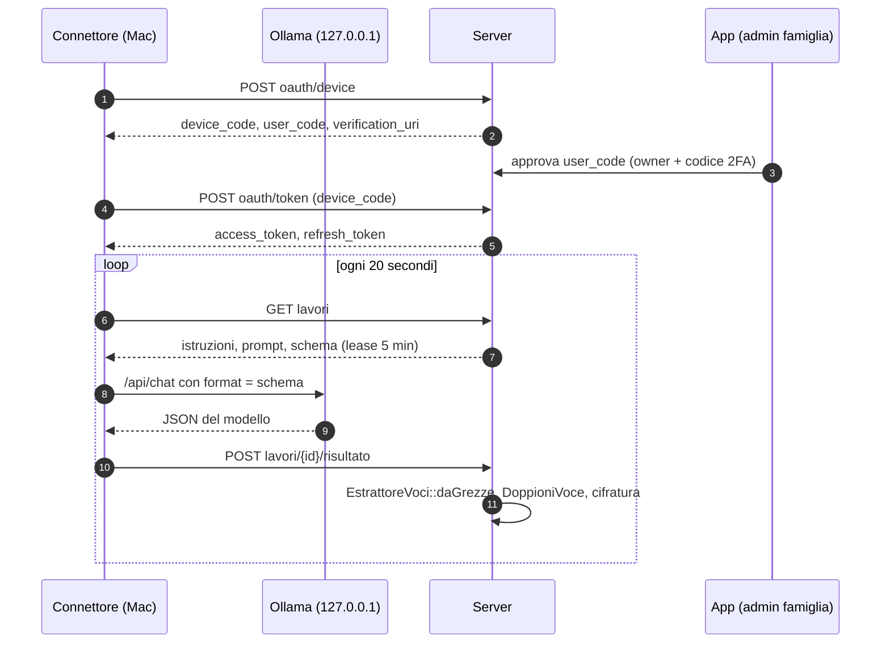

# Connettore AI per Mac

Specifica del 14/11/2026. Stato: fasi 0, 1 (backend) e 2 (app) fatte il 15/11/2026; fase 3 (connettore macOS) prima versione funzionante, mancano distribuzione e aggiornamenti.

Un'app per macOS che esegue sul Mac della famiglia, con Ollama o con il modello di Apple, le analisi che oggi fa la VM. Il connettore si collega al server, prende i lavori e restituisce **solo i valori letti dal modello**; il server li ricontrolla con le stesse regole di sempre. Se il Mac è spento, il lavoro torna alla VM.

È la stessa idea dell'analisi sull'iPhone (fase 2c di `docs/pratiche.md`), con tre differenze: lavora in background anche ad app chiusa, ha un'autenticazione propria a portata ridotta, e ha il ritorno automatico al server.

## Perché

- **Velocità.** La VM ha 2 vCPU e un'analisi alla volta: sui 9 documenti del 730/2025 di prova servono circa 3 minuti con qwen3 4B; il modello Apple sul simulatore (Apple Intelligence del Mac) ne impiega 40 secondi (`docs/pratiche.md`, fase 2c).
- **Memoria della VM.** Ollama ha un tetto di 5 GB dopo due blocchi della VM: meno lavoro sul server, meno rischio.
- **Missione.** Il calcolo si sposta su un computer della famiglia: i dati non vanno a terzi e nemmeno all'AI del server.
- **Self-host.** Chi installa CartellaViva su un server piccolo può usare il Mac per l'AI: il connettore accetta un indirizzo del server diverso da quello predefinito.

## Perimetro

Prima versione:

- l'analisi dei documenti per le **pratiche** (`AnalizzaDocumentoPraticaMessage`), per le pratiche con `analisiSu = server`;
- dal 18/11/2026 anche i **dati dell'indice** dei documenti in chiaro (`IndicizzaDocumentoMessage`: emittente, data, importo, numero, intestatario, riferimenti, tag; vedi "Analisi del testo" più sotto);
- dal 18/11/2026 anche la **classificazione automatica** dei documenti importati (`ClassificaDocumentoMessage`) e la **proposta di categoria** del wizard (`POST …/proposta-categoria`), anche per i documenti cifrati (vedi "Classificazione" più sotto);
- motore **Ollama** sul Mac;
- un connettore attivo per famiglia (più connettori sono ammessi dal modello dati, ma la prima versione ne usa uno: il più recente online).

Dopo (fase 4): modello Apple sul Mac, scadenze (`ProponiScadenzaMessage`), pagamenti (`ProponiPagamentoMessage`), avviso immediato con Mercure.

Fuori, per scelta:

- **embedding**: restano sul server con `OLLAMA_EMBED_MODEL` (bge-m3). Un altro modello darebbe vettori incompatibili con l'indice pgvector; con lo stesso modello e lo stesso digest i vettori sarebbero compatibili, ma è da verificare prima di spostarli;
- **OCR**: resta Tesseract sul server (Apple Vision sul Mac è un'idea per dopo, ma cambia il testo di riferimento su cui si ricontrollano i valori);
- pratiche con `analisiSu = telefono`: restano dell'iPhone.

## Come funziona



1. Il documento finisce l'OCR; `onOcrCompletato` mette in coda `AnalizzaDocumentoPraticaMessage` come oggi.
2. Il gestore controlla se la famiglia ha un connettore **online** (contatto negli ultimi 90 secondi, non revocato). Se sì, crea un `LavoroAi` in attesa e **non chiama Ollama**. Altrimenti analizza sul server come oggi.
3. Il connettore chiede i lavori; il server ne assegna uno con un lease di 5 minuti e costruisce **in memoria** istruzioni, prompt e schema, con le stesse funzioni dell'iPhone (`lavoriTelefono`).
4. Il connettore chiama Ollama in locale e manda la risposta grezza del modello.
5. Il server ricontrolla le voci sul testo (`EstrattoreVoci::daGrezze`), toglie i doppioni (`DoppioniVoce`), le cifra (`PraticaCifratura`) e le salva come proposte con origine `ai_connettore`.
6. Lease scaduto o connettore sparito: un'attività pianificata rimette il lavoro al server.

### Analisi del testo (dati dell'indice)

Dal 18/11/2026. Con il Mac della famiglia online, `IndicizzaDocumentoHandler` calcola sul server solo i vettori (bge-m3, leggero) e crea un `LavoroAi` di tipo `indice_dati` (`LavoriIndice::instrada`): il server non chiama qwen3. I dati già salvati restano finché arriva la risposta del Mac.

- La richiesta è quella di sempre (`AiEstrattoreDati::richiesta`: stesse istruzioni, testo entro `app.classifier_max_chars`, schema con le date trovate nel testo); `pratica` nella risposta di `GET /lavori` vale "Analisi del testo".
- La risposta del Mac passa da `AiEstrattoreDati::interpreta`, gli stessi controlli sul testo dell'Ollama del server: un emittente, un importo o un codice che non compare nel testo si scarta. Si salvano solo i dati (`IndiceDocumenti::salvaDati`), i vettori restano; la data del documento si mette solo se manca. `risultato` risponde `{"voci": n}` con il numero di dati validi.
- Solo documenti in chiaro: un documento diventato cifrato nel frattempo non arriva al Mac (il lavoro si cancella all'assegnazione) e la risposta non si salva.
- Errori, lease scaduti e Mac sparito come per le pratiche; il ritorno al server è `IndicizzaDocumentoMessage` con `forzaServer` e `soloDati`: la VM rifà solo i dati.
- Nell'audit `documento.indicizzato` con il modello e l'id del connettore, mai i dati.

Misura del 18/11/2026 su una bolletta inventata: 10 secondi sul MacBook Air M3 con qwen3 4B, circa 3 minuti sulla VM.

### Classificazione

Dal 18/11/2026. La classificazione automatica degli import e la proposta di categoria del wizard sono catene di domande al modello: la scelta tra le categorie, poi la descrizione della categoria (solo per quelle della famiglia: per quelle di sistema è scritta a mano in `categorie.yaml`), la verifica sì/no (negli import dal 21/11/2026) e, solo nel wizard, se nessuna va bene, una categoria nuova. Le regole restano in `ClassificazioneAutomatica` e `PropostaCategoria`; le domande e l'interpretazione delle risposte in `AiCategoryClassifier` (`richiesta…` e `interpreta…`).

- Con il Mac online la catena gira con `ClassificatoreSulMac` (`LavoriClassificazione`): ogni volta si rifà dall'inizio, le domande già fatte hanno il loro risultato, la prima senza risposta è il passo del lavoro e va al Mac. Arrivata la risposta, la catena riparte: finisce, o il lavoro torna in attesa con la domanda dopo (senza contare un tentativo). Una domanda si riconosce dall'impronta SHA-256 di istruzioni, prompt e schema: se intanto cambiano il documento o gli esempi delle categorie, la risposta vecchia riceve `409` e la domanda si rifà.
- In `lavoro_ai.dati` restano solo i risultati interpretati (la categoria scelta, il sì/no, la descrizione della categoria, la proposta finale), mai testo, prompt o risposte grezze. La riga si cancella alla fine.
- **Documenti cifrati**: vanno al Mac anche loro (decisione del 18/11/2026: il Mac è della famiglia). Il testo si decifra in memoria a ogni passo; l'audit, come sul server, non dice la proposta di un cifrato.
- **Wizard**: la prima richiesta avvia la proposta sul Mac e risponde `429` con `Retry-After: 4` e "Il Mac della famiglia sta analizzando il documento."; il wizard già aspetta e ripete la stessa richiesta (nessuna modifica alle app), che a proposta finita riceve l'esito una volta sola. Il limite orario si conta una volta per proposta. Se il Mac sbaglia due volte, o non è più online mentre il lavoro aspetta, la richiesta successiva la fa il server. Le proposte mai ritirate (wizard chiuso) si cancellano dopo un'ora.
- **Import**: il gestore crea il lavoro e non chiama Ollama; il Mac sposta il documento con le stesse regole (la cifratura non si toglie mai in automatico). Il ritorno al server è `ClassificaDocumentoMessage` con `forzaServer`.

Misura del 18/11/2026 sul MacBook Air M3 con qwen3 4B, su una fattura veterinaria inventata: circa 4 secondi per domanda; la catena (scelta, descrizione, verifica, categoria nuova) ha scartato "Casa" e proposto "Veterinario".

## Modello dati

Nuovo modulo `backend/src/ConnettoreAi/` (Entity, Repository, Controller, Security, Message, MessageHandler).

**`connettore_ai`**: un Mac collegato a una famiglia.

| Colonna | Tipo | Note |
| --- | --- | --- |
| `id` | uuid | |
| `tenant_id` | uuid, FK | la famiglia; `ON DELETE CASCADE` |
| `nome` | varchar(80) | "MacBook di Mario", scelto dal connettore e modificabile nell'app |
| `approvato_da_id` | uuid, FK user | chi l'ha approvato; `ON DELETE SET NULL` (e il connettore si revoca) |
| `approvato_il`, `revocato_il` | timestamp | revocato = nessun token valido |
| `access_token_hash`, `access_scade_il` | varchar(64), timestamp | sha256 del token; 1 ora |
| `refresh_token_hash`, `refresh_scade_il` | varchar(64), timestamp | sha256; 30 giorni, a uso singolo, la scadenza non si rinnova (come `gesdinet_jwt_refresh_token`) |
| `ultimo_contatto` | timestamp | aggiornato a ogni richiesta autenticata |
| `versione`, `sistema`, `chip`, `memoria_gb` | varchar, int | da `PUT /me` |
| `motore`, `modello`, `modello_digest`, `contesto` | varchar, int | `ollama` o `apple`; nome, digest sha256 e contesto in token |
| `lavori_fatti`, `durata_media_ms` | int | per la pagina dell'app |

**`connettore_ai_richiesta`**: la richiesta di abbinamento (device authorization grant).

| Colonna | Tipo | Note |
| --- | --- | --- |
| `id` | uuid | |
| `device_code_hash` | varchar(64) | sha256 del `device_code` (`TokenCasuale::nuovo()`) |
| `user_code` | varchar(9), unico tra le richieste vive | `XXXX-XXXX`, alfabeto senza caratteri ambigui (`BCDFGHJKLMNPQRSTVWXZ`), come l'esempio della RFC 8628 |
| `nome_proposto` | varchar(80) | |
| `stato` | varchar(10) | `in_attesa`, `approvata`, `negata`, `usata` |
| `tenant_id`, `approvata_da_id` | uuid, null | impostati all'approvazione |
| `scade_il` | timestamp | 10 minuti |
| `ultimo_poll_il` | timestamp | per `slow_down` |

**`lavoro_ai`**: la coda dei lavori per i connettori. Non contiene testo né prompt: si costruiscono al momento dell'assegnazione e vivono solo in memoria. Per le classificazioni `dati` tiene lo stato della catena (vedi "Classificazione").

| Colonna | Tipo | Note |
| --- | --- | --- |
| `id` | uuid | |
| `tenant_id` | uuid, FK | |
| `tipo` | varchar(20) | `pratica_voci`, `indice_dati`, `classificazione`, `proposta_categoria` (poi `scadenza`, `pagamento`) |
| `pratica_id`, `documento_id` | uuid, FK | `ON DELETE CASCADE`; unico (`tipo`, `pratica_id`, `documento_id`); `pratica_id` solo per `pratica_voci`, e senza pratica un lavoro per tipo e documento (`uniq_lavoro_ai_documento`) |
| `stato` | varchar(10) | `in_attesa`, `assegnato`; per le proposte anche `pronto` (esito da ritirare) e `al_server` |
| `dati` | json, null | stato della catena di classificazione: parametri del wizard, risultati interpretati, passo in corso, esito |
| `connettore_id` | uuid, null | chi lo ha preso |
| `assegnato_il`, `scade_il` | timestamp, null | lease |
| `tentativi` | smallint | |
| `creato_il` | timestamp | |

Un lavoro concluso si **cancella** (il risultato sta in `pratica_analisi` e `pratica_voce`): la tabella resta piccola.

**Modifiche a tabelle esistenti:**

- `VoceOrigine`: nuovo caso `AI_CONNETTORE = 'ai_connettore'`.
- `pratica_analisi`: colonne nullable `modello` (varchar 100), `durata_ms` (int), `connettore_ai_id` (uuid, `ON DELETE SET NULL`). `metodo` resta entro 20 caratteri: `mac:` più il nome breve del modello (es. `mac:qwen3-4b`). Servono per il registro dei modelli usati e per misurare.
- `pratica`: nuova colonna `consenso_cifrati_dispositivi_il` (timestamp, null). Vedi "Documenti cifrati".

## Autenticazione: OAuth 2.0 Device Authorization Grant

Protocollo della [RFC 8628](https://rfc-editor.org/rfc/rfc8628), implementato con ciò che c'è già (Symfony Security, `TokenCasuale`, `AuditLogger`, rate limiter), **senza** il server OAuth di league: serve un solo grant e un solo client. Il connettore non vede mai la password dell'admin e non riceve un JWT utente.

**Firewall dedicato**, prima di `api` in `security.yaml`:

```yaml
ai_connector:
    pattern: ^/api/ai-connector-plugin
    stateless: true
    access_token:
        token_handler: App\ConnettoreAi\Security\TokenConnettoreHandler
```

- `TokenConnettoreHandler` cerca l'hash del token in `connettore_ai`, rifiuta i revocati e gli scaduti, controlla che chi l'ha approvato abbia ancora `connettore_ai:manage` nella famiglia (altrimenti revoca) e restituisce un `ConnettoreUser` con `ROLE_CONNETTORE_AI` e il tenant.
- `access_control`: `^/api/ai-connector-plugin/oauth/(device|token)$` pubblici; il resto del prefisso `ROLE_CONNETTORE_AI`.
- Il token del connettore **non** vale sul firewall `api`: con quel token ogni altra rotta risponde 401. Va coperto da un test.

**Permesso** nuovo `connettore_ai:manage` in `permissions.yaml`: lo ha solo `owner` (che ha `*`). Dopo la modifica: `app:permissions:sync` e `app:roles:sync`.

**Flusso:**

1. `POST /api/ai-connector-plugin/oauth/device` (form o JSON) `{client_id: "cartellaviva-mac", nome: "MacBook di Mario"}` → `{device_code, user_code, verification_uri: "https://<dominio>/collega-mac", verification_uri_complete: "https://<dominio>/collega-mac?codice=WDJB-MJHT", expires_in: 600, interval: 5}`. Limite: 5 richieste all'ora per IP (`rate_limiter.yaml`, nuovo `connettore_device`).
2. Nell'app, l'admin apre il link o scrive il codice e approva: `POST /api/tenants/{tenantId}/connettori-ai/approva` `{userCode, nome?, codice2fa?, password?}` sul firewall `api`. Serve `connettore_ai:manage` e sempre una conferma, perché il Mac riceverà il testo dei documenti: con la 2FA attiva un codice valido (stessa verifica del login); senza 2FA la password dell'account (403 se manca, 422 se sbagliata, con audit `connettore_ai.approvato` esito `FAILURE` e il limite `connettore_password`: 5 password sbagliate ogni 15 minuti per utente); chi non ha né 2FA né password (accesso solo con Google) riceve 409 e deve prima attivare una delle due. L'app mostra sopra i pulsanti un avviso: approvare solo se il codice è sullo schermo di un Mac proprio, davanti a sé. `POST .../connettori-ai/nega` `{userCode}` rifiuta. Entrambi in `AuditLogger`.
3. Il connettore interroga `POST /api/ai-connector-plugin/oauth/token` con `grant_type=urn:ietf:params:oauth:grant-type:device_code`, `device_code`, `client_id`. Risposte d'errore come da RFC (`400` con `error`): `authorization_pending`, `slow_down` (se interroga prima di `interval`), `access_denied`, `expired_token`. Al successo la richiesta passa a `usata`, nasce il `connettore_ai` e la risposta è `{access_token, token_type: "Bearer", expires_in: 3600, refresh_token, scope: "ai-connector"}`. La richiesta si legge con un blocco in scrittura (`SELECT … FOR UPDATE`, in transazione): due scambi insieme dello stesso codice creano un solo connettore. A chi ha approvato arriva un'email con il nome del Mac, data e ora e dove scollegarlo (Sicurezza e accesso → AI sul tuo Mac).
4. Rinnovo: stesso endpoint con `grant_type=refresh_token`. Il refresh token si consuma e se ne emette uno nuovo con la stessa scadenza. Il refresh token di prima vale ancora per 60 secondi dalla rotazione (`ConnettoreAi::TOLLERANZA_SECONDI`), se la risposta non è arrivata al Mac: dà una nuova coppia di token, i token emessi alla rotazione non valgono più e la finestra non si allunga (la rotazione si ricava da `access_scade_il` meno `ACCESSO_SECONDI`, senza colonne in più). Dopo i 60 secondi un refresh token già usato revoca il connettore (possibile furto; audit `connettore_ai.scollegato`, motivo `refresh_riusato`). Un rinnovo alla volta per connettore (blocco in scrittura). Il prezzo della tolleranza: chi avesse copiato il refresh token e lo usasse entro 60 secondi dalla rotazione otterrebbe token validi; il Mac vero a quel punto viene scollegato al rinnovo successivo, e il proprietario lo vede.
5. Revoca dall'app: `DELETE /api/tenants/{tenantId}/connettori-ai/{id}`. Effetto immediato: token non validi, lavori assegnati rimessi in attesa.

Tutti i token sono `TokenCasuale::nuovo()`; a database solo l'hash sha256.

## API del connettore

Prefisso `/api/ai-connector-plugin`, `Authorization: Bearer <access_token>`. Errori nel formato di sempre (`MessaggioErroreNormalizer`). Ogni richiesta autenticata aggiorna `ultimo_contatto`.

**`PUT /me`**: il connettore si presenta all'avvio e ogni 60 secondi.

```json
{
  "versione": "1.0.0",
  "sistema": "macOS 26.1",
  "chip": "Apple M2",
  "memoriaGb": 16,
  "motore": "ollama",
  "modello": "qwen3:4b-instruct-2507-q4_K_M",
  "digest": "sha256:…",
  "contesto": 8192
}
```

Risposta: `{famiglia: {nome}, intervalloSecondi: 20, caratteriMax: 12000, modelliVerificati: ["qwen3:4b-instruct-2507-q4_K_M"], sperimentaliAmmessi: false}`. `modelliVerificati` viene da un parametro (`app.connettore_ai.modelli_verificati` in `services.yaml`): sono i modelli provati sul banco (`app:pratiche:prova-cartella`).

**`GET /lavori?limite=1&caratteri=12000`**: prende fino a `limite` lavori (massimo 3) in attesa per la famiglia, con `SELECT … FOR UPDATE SKIP LOCKED`, li assegna con lease di 5 minuti e restituisce:

```json
{
  "lavori": [
    {
      "id": "…",
      "tipo": "pratica_voci",
      "pratica": "730 2026",
      "documento": "Scontrino farmacia 12/03",
      "istruzioni": "…",
      "prompt": "…",
      "schema": "{…}",
      "scadeIl": "2026-11-20T21:05:00+01:00"
    }
  ],
  "restano": 6
}
```

Le istruzioni, il prompt e lo schema si costruiscono come in `PraticheService::lavoriTelefono` (estrarre la parte comune in un metodo, per esempio `PraticheService::lavoroPerDocumento`). `caratteri` lo calcola il connettore dal contesto, con la formula dell'iPhone: (contesto − 1500) × 3, tra 1.500 e 12.000. Se il documento non è più da guardare (`CandidatiPratica::daGuardare`), il lavoro si cancella e non si restituisce. Nessun lavoro: `{lavori: [], restano: 0}`.

**`POST /lavori/{id}/proroga`**: allunga il lease di 5 minuti (il connettore la chiama ogni 60 secondi durante un'analisi lunga: così resta anche online, perché dopo 90 secondi senza contatti il server lo considera spento). 409 se il lavoro non è più suo.

**`POST /lavori/{id}/risultato`**:

```json
{
  "risposta": "{\"voci\":[…]}",
  "modello": "qwen3:4b-instruct-2507-q4_K_M",
  "digest": "sha256:…",
  "durataMs": 4210,
  "tokenPrompt": 2210,
  "tokenRisposta": 180
}
```

Il server fa ciò che fa `risultatoTelefono` (estrarre la parte comune), con origine `ai_connettore`, registra `pratica_analisi` con `metodo`, `modello`, `durata_ms` e `connettore_ai_id`, aggiorna `lavori_fatti` e `durata_media_ms`, cancella il lavoro. Risposta `{voci: n}`. 409 se il lavoro non è del connettore, se il lease è scaduto o se il documento è già stato analizzato. Corpo massimo 64 KB.

Se `modello` non è tra i verificati e `sperimentaliAmmessi` è falso, il server rifiuta con 409: il connettore non deve usare quel modello per i lavori. Il nome del modello (e il digest) li dichiara il connettore: è una dichiarazione, non una prova, e un connettore modificato può dichiarare quello che vuole. La garanzia vera resta il ricontrollo dei valori sul testo del documento fatto dal server (`EstrattoreVoci`): un valore che il testo non contiene si scarta, qualunque modello l'abbia proposto.

**`POST /lavori/{id}/errore`** `{codice: "modello_mancante" | "timeout" | "memoria" | "risposta_non_valida" | "interrotto"}`: il lavoro torna in attesa con `tentativi + 1`; dal secondo errore va al server. Al server arriva solo il codice, mai un messaggio con testo del documento (come per l'iPhone).

Limiti: `GET /lavori` al massimo una volta ogni 5 secondi per connettore (429 con `Retry-After`).

## Instradamento e ritorno al server

- **`AnalizzaDocumentoPraticaHandler::__invoke`**: dopo i controlli di oggi e prima di leggere il testo, se `ConnettoriAi::online($tenant)` e il messaggio non ha `forzaServer`, crea il `LavoroAi` (se non esiste) e termina. Aggiungere `forzaServer: bool = false` ad `AnalizzaDocumentoPraticaMessage`.
- **`PraticheService::analizza`** ("Cerca di nuovo"): stessa regola, tramite il messaggio.
- **Attività pianificata** in `Schedule.php`, ogni minuto (`RiprendiLavoriAiMessage`):
    - lease scaduti → `in_attesa`, `tentativi + 1`;
    - lavori di famiglie senza connettore online da più di `app.connettore_ai.attesa_massima` (predefinito 10 minuti), o con `tentativi >= 2` → cancellati e rimandati al server con `forzaServer: true`.
- **Doppia analisi**: il vincolo unico di `pratica_analisi` (pratica, documento) resta la protezione finale, come oggi tra due worker.
- **Pratica chiusa o documento eliminato**: il lavoro sparisce con le cascade, o si cancella alla prima assegnazione.

## Documenti cifrati

Oggi il consenso della pratica fa leggere i cifrati all'AI del server e dell'iPhone. Per il Mac serve un consenso che lo nomini:

- nuova colonna `pratica.consenso_cifrati_dispositivi_il`, data con un'azione esplicita nell'app ("Consenti anche ai dispositivi collegati della famiglia, come il Mac");
- senza quel consenso, i lavori su documenti cifrati **non** vanno al connettore ma restano al server: il gestore controlla il consenso prima di creare il `LavoroAi`;
- revoca del consenso = i lavori cifrati in attesa tornano al server.

## App (Flutter)

- **Sicurezza e accesso → "AI sul tuo Mac"**, solo per chi ha `connettore_ai:manage`:
    - elenco dei Mac: nome, online o ultimo contatto, motore e modello, lavori fatti, tempo medio per documento; "Rinomina", "Scollega" (con conferma);
    - "Collega un Mac": link per scaricare il connettore, campo per il codice, oppure apertura del link `/collega-mac?codice=…`.
- **Rotta `/collega-mac`** (web e app, con il codice nella query): foglio con nome del Mac, famiglia, richiesta del codice 2FA se attiva, "Approva" e "Rifiuta". Un utente senza il permesso vede il motivo, non il pulsante.
- **Pratica**: voci con origine `ai_connettore` segnate "letta sul Mac"; nel consenso per i cifrati, la seconda spunta per i dispositivi.
- **Analisi AI** (pagina esistente): filtro per dove è stata fatta l'analisi (server, iPhone, Mac).

## Connettore (macOS)

Nuova cartella `connettore-mac/` nel repo: progetto Xcode, SwiftUI, licenza AGPL come il resto.

**Forma:** app nella barra dei menu (`MenuBarExtra`, `LSUIElement`), con una finestra "Impostazioni". Minimo macOS 13 per il motore Ollama (`MenuBarExtra`, `SMAppService`); il motore Apple, in fase 4, chiede macOS 26.

**Primo avvio, pensato per chi non è tecnico:**

1. **Server**: predefinito `https://app.cartellaviva.it`; in "Avanzate" si cambia (self-host).
2. **Ollama**: `GET http://127.0.0.1:11434/api/version`. Se non risponde: spiegazione in una riga, pulsante "Scarica Ollama" (sito ufficiale), controllo ogni 3 secondi finché risponde. Ollama non si include nel connettore.
3. **Modello**: `GET /api/tags`. Se manca quello consigliato (il primo di `modelliVerificati`): spazio libero sul disco, poi `POST /api/pull` con `stream: true` e barra di avanzamento. In "Avanzate" si sceglie tra i modelli installati: "verificato" o "sperimentale" accanto al nome, e un avviso se la memoria del Mac è poca per quel modello.
4. **Prova**: un'analisi su un testo di esempio incluso nel connettore (uno scontrino finto), con il tempo impiegato: l'utente vede subito che funziona.
5. **Abbinamento**: codice grande, QR del `verification_uri_complete` (si inquadra con l'iPhone già collegato) e pulsante "Apri nel browser"; il connettore interroga `oauth/token` ogni `interval` secondi.
6. **Avvio al login**: proposto con una spunta (`SMAppService.mainApp`).

**Ciclo dei lavori:**

- `PUT /me` all'avvio e ogni 60 secondi; `GET /lavori` ogni `intervalloSecondi`, subito dopo un lavoro finito.
- Un lavoro alla volta. Chiamata a Ollama:

```json
{
  "model": "qwen3:4b-instruct-2507-q4_K_M",
  "stream": false,
  "format": { "…": "schema del lavoro" },
  "options": { "temperature": 0, "num_ctx": 8192 },
  "keep_alive": "10m",
  "messages": [
    { "role": "system", "content": "istruzioni del lavoro" },
    { "role": "user", "content": "prompt del lavoro" }
  ]
}
```

- `think: false` solo se il modello lo supporta (`POST /api/show`, `capabilities` contiene `thinking`): è il caso di qwen3 8B, che senza questa opzione ragiona prima di rispondere ed è circa 10 volte più lento.
- Durata, `prompt_eval_count` ed `eval_count` dalla risposta di Ollama finiscono nel risultato.
- `proroga` ogni 60 secondi; timeout del lavoro 4 minuti, poi `errore: timeout`;
- il ciclo si ferma solo se il server rifiuta il refresh token (`invalid_grant` e simili: il Mac si scollega). Rete assente o server che non risponde lasciano il refresh token nel Portachiavi: si mostra l'errore e si riprova dopo l'intervallo (un rinnovo fallito per la rete si riprova una volta dopo 3 secondi). Un rinnovo alla volta. Al risveglio del Mac (`NSWorkspace.didWakeNotification`) un giro subito.
- Portachiavi mai sul thread principale: macOS può fermare una lettura finché l'utente non dà il permesso (succede dopo ogni nuova versione firmata ad hoc), e sul thread principale l'icona e il menu non comparirebbero. Letture e scritture passano da una coda seriale, nell'ordine; il refresh token si legge una volta all'avvio (stato "Avvio" nel menu, icona a clessidra) e poi si scrive soltanto.
- Durante un lavoro: `ProcessInfo.beginActivity` per evitare App Nap e la sospensione per inattività; nessuna attività tra un lavoro e l'altro.
- Batteria: con il Mac a batteria sotto il 20%, il connettore smette di chiedere lavori (impostazione predefinita, modificabile).

**Menu:** stato (Avvio · Pronto · Analizza "Scontrino farmacia" · In pausa · Ollama non risponde · Scollegato), lavori di oggi, "Pausa per 1 ora", "Impostazioni", "Esci".

**Riservatezza sul Mac:**

- il testo dei documenti vive solo in memoria: niente file temporanei, niente cache su disco, niente log con contenuti (`os_log` solo con id e tempi; campi dinamici `.private`);
- Ollama solo su `127.0.0.1`. All'avvio il connettore prova a raggiungere Ollama dall'IP di rete del Mac: se risponde, avvisa che Ollama è esposto alla rete (`OLLAMA_HOST`) e spiega come chiuderlo;
- refresh token nel Portachiavi, `kSecAttrAccessibleAfterFirstUnlockThisDeviceOnly`, mai sincronizzato su iCloud; access token solo in memoria;
- solo HTTPS verso il server configurato.

**Distribuzione:**

- firma **Developer ID Application**, hardened runtime, notarizzazione con `notarytool` e staple, distribuito come DMG;
- aggiornamenti con **Sparkle 2** e feed firmato EdDSA; la chiave privata di Sparkle fuori dal repo, come gli altri segreti;
- DMG nelle release del repo pubblico; il link nell'app punta all'ultima release;
- `DEVELOPMENT_TEAM` e identificativi di firma in un `.xcconfig` locale escluso da git, come per l'app iOS.

## Riservatezza e sicurezza: controlli

- [ ] Il token del connettore non apre nessuna rotta fuori dal prefisso (test funzionale su un campione di rotte `/api/tenants/...`).
- [ ] Un connettore vede solo i lavori della propria famiglia.
- [ ] Nessun testo, prompt o risposta in `lavoro_ai`, nei log del server o nell'audit.
- [ ] Valori del modello non presenti nel testo scartati dal server (`EstrattoreVoci`), come per l'iPhone.
- [ ] Cifrati al connettore solo con `consenso_cifrati_dispositivi_il`.
- [ ] Refresh token riusato dopo 60 secondi dalla rotazione = connettore revocato; entro 60 secondi nuovi token.
- [ ] Approvazione sempre con conferma (codice 2FA o password); email a chi ha approvato quando il Mac si collega.
- [ ] Chi ha approvato perde il permesso = connettore revocato alla richiesta successiva.
- [ ] Limiti di frequenza su `oauth/device`, `oauth/token` (`slow_down`) e `lavori`.
- [ ] Le attività di sicurezza della produzione (segreti ruotati, token di accesso al repository revocati, accesso SSH limitato, superadmin con 2FA, master key esportata, backup fuori dal server, DMARC) chiuse **prima** di attivare il connettore in produzione.

## Test

**Backend (PHPUnit funzionali):**

- device flow: richiesta, `authorization_pending`, `slow_down`, approvazione, token, `access_denied`, `expired_token`;
- approvazione: senza permesso 403, senza codice 2FA (se attiva) 403, codice di un'altra famiglia o scaduto 404;
- refresh: rotazione, riuso = revoca;
- firewall: il token del connettore su rotte `api` dà 401; un JWT utente sulle rotte del connettore dà 401;
- instradamento: connettore online → `LavoroAi` e nessuna chiamata a Ollama; offline → analisi sul server;
- lease: scadenza, proroga, risultato fuori tempo (409);
- ritorno al server: dopo `attesa_massima` e dopo due errori;
- risultato: voci ricontrollate, origine `ai_connettore`, `pratica_analisi` con modello e durata; doppio invio 409;
- cifrati: senza consenso per i dispositivi non diventano lavori del connettore;
- modello non verificato con `sperimentaliAmmessi: false` → 409.

PHPStan pulito, come oggi.

**Comando di prova** `app:connettore-ai:simula --server=… --token=…` (solo sviluppo): fa il ciclo del connettore in PHP contro `OLLAMA_URL`. Serve per provare il server senza l'app Mac e per misurare.

**Connettore (XCTest):** macchina a stati dell'abbinamento, client di Ollama e del server con `URLProtocol` finto, calcolo di `caratteri`, nessun contenuto nei log.

**Prova a mano:** Mac con Ollama, pratica 730 di prova, 9 documenti; poi Mac spento a metà (i lavori tornano al server); poi revoca dall'app durante un'analisi.

## Fasi

0. **Misura** (una sera): `app:pratiche:prova-cartella` sulla cartella del banco con `OLLAMA_URL` verso il Mac e verso la VM. Tempo totale, tempo per documento e token al secondo (`eval_count` / `eval_duration` di Ollama). Si procede se il Mac è nettamente più veloce.
1. **Backend**: entità e migrazioni, device flow, firewall, API dei lavori, instradamento, attività pianificata, comando di prova, test.
2. **App**: "AI sul tuo Mac", `/collega-mac`, origine "letta sul Mac", consenso per i dispositivi.
3. **Connettore**: Ollama, primo avvio guidato, ciclo dei lavori, Portachiavi, menu, firma, notarizzazione, Sparkle.
4. **Dopo**: motore Apple sul Mac (pacchetto Swift comune con `AppDelegate.swift` di iOS, che ha già la conversione dello schema JSON in `DynamicGenerationSchema`), classificazione, scadenze e pagamenti come nuovi `tipo`, avviso con Mercure (già dentro FrankenPHP) al posto del polling.

## Stato al 15/11/2026

**Fase 0, misura.** Stessa richiesta dell'app (estratto conto finto, ~1.150 token di prompt, qwen3 4B Q4_K_M, contesto 8.192, prompt diverso a ogni giro per non usare la cache): Mac M3 16 GB con Ollama nativo 7,4 s a documento, VM D2s 66 s; lettura del prompt ~470 contro 27 token/s, scrittura 26 contro 5,5. Sul banco ISEE 2026 il Mac fa 22 documenti all'AI in circa 4 minuti.

**Correzioni dopo la revisione del 16/11/2026.** Approvazione con conferma obbligatoria ed email al collegamento; tolleranza di 60 secondi sul refresh token; scambio e rinnovo con blocco in scrittura; proroga del Mac ogni 60 secondi; ciclo del Mac che non si ferma per un errore di rete; il modello "verificato" descritto come dichiarazione del connettore.

**Fase 1, backend.** Modulo `backend/src/ConnettoreAi/`, migrazione `Version20261115100000`, test `ConnettoreAiTest` (7 test: abbinamento, 2FA, firewall separati, refresh a uso singolo, instradamento e risultato, lease ed errori, ritorno al server, revoca, consenso dei cifrati per i dispositivi). Scelte rispetto alla specifica:

- il riuso di un refresh token si riconosce dall'ultimo consumato (`refresh_precedente_hash`), senza una tabella in più;
- `pratica_analisi.connettore_ai_id` è una relazione Doctrine (`ON DELETE SET NULL`);
- i valori predefiniti di "Da decidere": approvazione solo con `connettore_ai:manage` (solo `owner`), `attesa_massima` 600 secondi, modelli sperimentali non ammessi.

**Comando di prova** `app:connettore-ai:simula [--nome=…|--token=…] --server=http://localhost:8080 --ollama=http://host.docker.internal:11434`: abbina (mostra il codice da approvare) e fa il ciclo del connettore. Provato in sviluppo con l'Ollama nativo del Mac su una pratica ISEE di prova: i documenti diventano lavori, il Mac li analizza, il server ricontrolla e salva le voci con origine `ai_connettore`.

**Fase 2, app.** `lib/features/connettore_ai/`: scheda "AI sul tuo Mac" in Sicurezza e accesso (solo con `connettore_ai:manage`: elenco con stato, chip, modello, tempo medio, documenti analizzati; Rinomina, Scollega con conferma; "Collega un Mac"), rotta `/collega-mac?codice=…` (cerca la richiesta, nome modificabile, codice 2FA se attiva, Approva o Rifiuta), voci "Letta sul Mac" e "Letta sull'iPhone" nella pratica, e nel consenso per i cifrati la spunta "Anche ai dispositivi collegati della famiglia". Provata sul simulatore con il connettore simulato.

**Fase 3, connettore macOS (prima versione).** Cartella `connettore-mac/` ([README](../connettore-mac/README.md)): pacchetto Swift al posto del progetto Xcode (niente identificativo del team nel repository), `scripts/crea-app.sh` per la `.app` (LSUIElement, hardened runtime, firma ad hoc o Developer ID). App nella barra dei menu con finestra di configurazione: server, Ollama, modello (scarica e prova), collegamento con codice grande e QR, avvio al login, pausa con batteria sotto il 20%; ciclo dei lavori con `PUT /me` ogni 60 secondi, proroga ogni 60 secondi (era 2 minuti: oltre i 90 secondi di `ONLINE_SECONDI`), timeout 4 minuti, `beginActivity`, `think: false` per i modelli che ragionano; refresh token nel Portachiavi. Provata sul Mac M3 contro il server di sviluppo: collegamento approvato, documenti analizzati in circa 8 secondi l'uno. Mancano: Sparkle, icona, DMG e notarizzazione (serve Developer ID), test su più Mac.

## Da decidere

- Nome dell'app: "CartellaViva Connettore", "CartellaViva per Mac" o altro.
- Approvazione solo per `owner`, o anche per un ruolo dedicato.
- `attesa_massima`: 10 minuti, o meno per chi carica e aspetta il risultato.
- Modelli sperimentali ammessi o no per impostazione predefinita.
- Più connettori per famiglia: dal primo libero, o dal più veloce (`durata_media_ms`).

## Vincoli del repo

Nessun segreto nel repo, `DEVELOPMENT_TEAM` solo in locale, niente operazioni distruttive sui dati, commit e push solo su richiesta. Testi e commenti in italiano.
